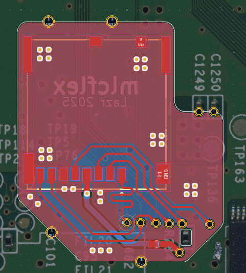
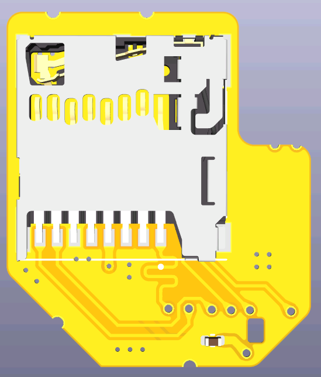
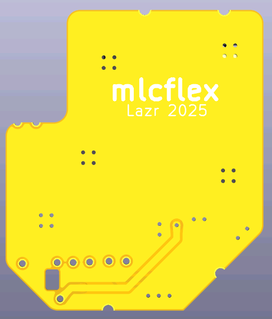
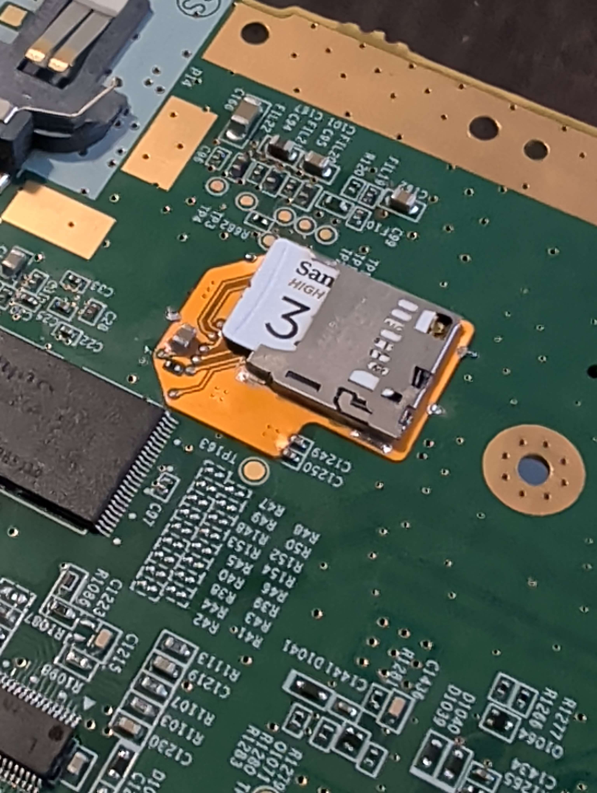
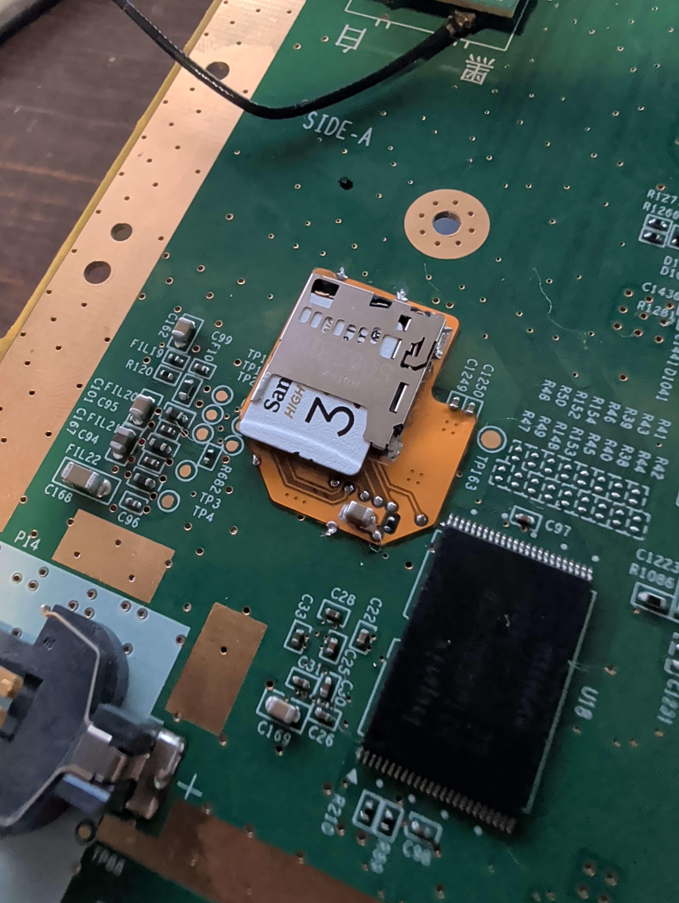

# mlcflex
mlcflex is a flex PCB SD Card interposer for the Wii U. It is intended to be used to replace dying Hynix eMMC NANDs with a microSD slot.

## BOM
- Molex 503398-1892 (can be found on most parts distributers)
- 0805 22uF MLCC

## KiCAD Pics

## Install Pics

## Credits
- [jan-hofmeier/SDIO](https://github.com/jan-hofmeier) for the original [PoC SD Card replacement](https://gbatemp.net/threads/626448/) and [mlc2sd](https://github.com/jan-hofmeier/mlc2sd).
- [YveltalGriffin](https://github.com/mackieks) for [cafeFlex](https://github.com/mackieks/cafeFlex) which showed me the Molex SD Card slot used on this PCB, as well as teaching me some basics with flex PCB designing in KiCAD.
- JechtZero on the BitBuilt discord for testing the flex and the install pictures.
